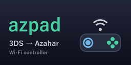

<h1 align="center">azpad</h1>

3DS を Azahar のコントローラーにする / Use your 3DS as a controller for Azahar

実機の 3DS のボタンとスライドパッドを Wi-Fi で PC に送り、PC の 3DS エミュレータ Azahar を操作します。 
Send the buttons and Circle Pad of a real 3DS to your PC over Wi-Fi to play games in Azahar, the 3DS emulator.

## 主な機能 / Features

- 3DS のボタンを PC のキーとして押す（Azahar のボタンの設定はそのままでよい） / Buttons are pressed as PC keys (no need to change Azahar's button settings)
- 割り当ては 3DS の画面で決める。Azahar のいまの割り当てから始まる / Set the mapping on the 3DS; it starts from your current Azahar controls
- スライドパッドを 360° で送れる（仮想 Xbox 360 コントローラー） / 360° Circle Pad through a virtual Xbox 360 controller
- 下画面が PC のマウスのタッチパッドになる / The bottom screen works as a touchpad for the PC mouse
- プレイ中は画面を暗くして電池を節約 / Screens go dark while playing to save battery
- 最初につないだ 3DS 以外からは操作できない / Only the first 3DS that connects can control the PC

3DS アプリの画面は日本語です。 / The 3DS app's screens are in Japanese.

## 必要なもの / Requirements

- カスタムファームウェア（Luma3DS など）を導入した Nintendo 3DS / A Nintendo 3DS with custom firmware (e.g. Luma3DS)
- Windows の PC（[Azahar](https://azahar-emu.org/) と [Python 3](https://www.python.org/)） / A Windows PC with [Azahar](https://azahar-emu.org/) and [Python 3](https://www.python.org/)
- 3DS と PC が同じ Wi-Fi につながっていること / The 3DS and the PC on the same Wi-Fi network

Old 3DS で確認しています。 / Tested on the Old 3DS.

## インストール / Install

**3DS**

| FBI |
|:---:|
|  |
| Remote Install → Scan QR Code |

または [Releases](https://github.com/nyon-dev/azpad/releases/latest) から `azpad.cia` をダウンロードして、FBI などでインストールしてください。 
Or download `azpad.cia` from [Releases](https://github.com/nyon-dev/azpad/releases/latest) and install it with FBI or another CIA installer.

**PC**

[Releases](https://github.com/nyon-dev/azpad/releases/latest) から `azpad-v*.zip` をダウンロードして、中の `pc` フォルダを好きな場所に置いてください。 
Download `azpad-v*.zip` from [Releases](https://github.com/nyon-dev/azpad/releases/latest) and put its `pc` folder anywhere on your PC.

## 使い方 / Usage

1. PC の `pc` フォルダで `py azpad_server.py` を実行し、表示される PC の IP を覚えます（ファイアウォールの確認が出たらプライベート ネットワークを許可）。 
   Run `py azpad_server.py` in the `pc` folder and note the PC IP it shows (allow private networks if Windows Firewall asks).
2. 3DS で azpad を起動し、右上の「PC 192.168.x.x」をタッチしてその IP を入れます（初回だけ）。 
   Start azpad on the 3DS, touch "PC 192.168.x.x" at the top right and enter that IP (first time only).
3. 「新規作成」→「確定」で、Azahar と同じ割り当てのキーマップができます。 
   "新規作成" (New) → "確定" (Save) creates a keymap with the same mapping as Azahar.
4. キーマップを選んで「使う」。PC では Azahar を前面にしておきます。 
   Choose the keymap and press "使う" (Use). Keep Azahar in front on the PC.

スライドパッドを 360° にする方法、割り当ての変え方、PC 側のオプションは、zip の中の `README.txt` にあります。 
See `README.txt` in the zip for the 360° Circle Pad, changing the mapping and PC options.

## 注意 / Notes

- 通信は暗号化していません。信頼できる自宅の Wi-Fi で使ってください。 
  The connection is not encrypted. Use it on a trusted home network.
- PC 側は、起動してから最初につないだ 3DS だけを受け付けます。3DS の IP が変わったら PC 側を起動し直してください。 
  The PC program only accepts the first 3DS that connects. Restart it if the 3DS's IP changes.

## クレジット / Credits

libctru, citro2d, citro3d (devkitPro and contributors, zlib License)。360° のスライドパッドには [vgamepad](https://github.com/yannbouyeron/vgamepad) と [ViGEmBus](https://github.com/nefarius/ViGEmBus) を使います（利用者が別に入れます）。 
The 360° Circle Pad uses vgamepad and ViGEmBus (installed separately by the user). Details: `THIRD_PARTY_NOTICES.txt` in the zip.

## ライセンス / License

(c) 2026 nyon. All rights reserved.

- 任天堂・Azahar とは関係のない非公式の自作ソフトです。使用は自己責任でお願いします。 / Unofficial homebrew, not affiliated with Nintendo or the Azahar project. Use at your own risk.
- 無断での転載・改変・再配布はご遠慮ください。 / Please do not redistribute, modify or re-upload without permission.
